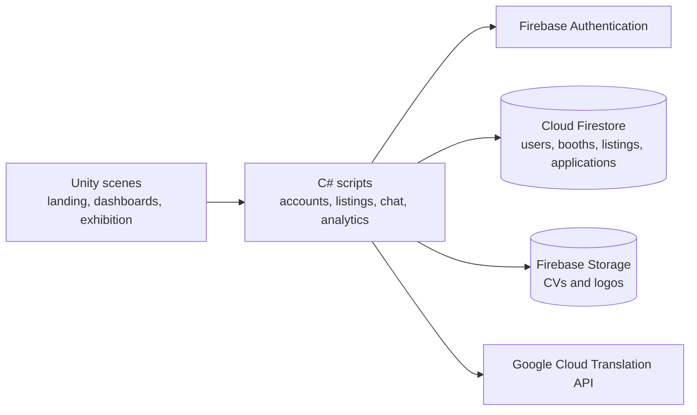

<div align="center">

# GlobeFair

**A 3D virtual career fair, built in Unity.**

Job seekers and businesses meet, browse booths, apply, chat and recruit inside one shared exhibition hall.

[Web version](https://github.com/youssefsadquy/globefair-web) · [Live demo](https://globefair-46eb2.web.app/) (password on request) · [Features](#features) · [Architecture](#architecture) · [Running the project](#running-the-project) · [Repository notes](#repository-notes)


</div>


<p align="center">
  <sub>The web rebuild in action. This repository holds the original desktop Unity project; the browser version lives in <a href="https://github.com/youssefsadquy/globefair-web">globefair-web</a>.</sub>
</p>

## Overview

GlobeFair began as my University of Leicester final-year project (October 2023 to May 2024). The brief was to rethink the traditional career fair as a virtual experience: an exhibition hall people can walk around, booths staffed by real businesses, and the practical tools both sides need to actually recruit.

This repository is the submitted desktop build, migrated from GitLab with its original commit history and dates. A later web version runs the same design in the browser.

The project set out to:

1. Turn the career fair into an explorable 3D space rather than a list of links.
2. Give businesses the tools to take part: a booth, a profile, job listings, Q&A, candidate lists and analytics.
3. Give job seekers one place to upload a CV, apply and track their applications.
4. Make the interface usable in more than one language without shipping separate builds.

## Features

### For job seekers

- Create an account, sign in and recover a forgotten password.
- Customise an avatar before entering the hall.
- Walk the exhibition floor in third person and visit business booths.
- Read a business profile, its Q&A and its open listings.
- Upload a PDF CV and apply to listings.
- Track every application from a personal dashboard.
- Chat with businesses.

### For businesses

- Separate business sign-up and dashboard.
- Select one of the free booths and set a logo and bio.
- Create, edit and remove job listings.
- Review applicants, including their listing and contact details.
- Publish questions and answers for visitors.
- View booth analytics: visits, unique visitors and applicant counts.
- Chat with candidates.

### For everyone

- Interface in English, Spanish, French and Italian, switched at runtime.
- Context-sensitive tutorial cards.
- Graphics quality, music volume and fullscreen settings.
- Feedback form.

## Architecture

The desktop client is a set of Unity scenes whose C# scripts talk to Firebase for authentication, data and file storage. Text that needs translating is sent to the Google Cloud Translation API at runtime.



Scene scripts are organised by area: `Assets/Scripts` for the landing and account screens, `Assets/Exhibition/Scripts` for the hall, booths and live content, and `Assets/Customiser/Scripts` for the avatar customiser.

### Main scenes

| Scene | Purpose |
|---|---|
| `Assets/Scenes/Landing.unity` | Entry point: sign-in, sign-up and password recovery |
| `Assets/Scenes/GlobeFair.unity` | The exhibition hall |
| `Assets/Customiser/PlayerCustomiser.unity` | Avatar customisation |

## Tech stack

| Layer | Technology |
|---|---|
| Engine | Unity 2021.3.26f1, Universal Render Pipeline |
| Language | C# |
| UI | Unity UI, TextMesh Pro |
| 3D | Unity Starter Assets, Cinemachine, custom booth and avatar models |
| Backend | Firebase Authentication, Cloud Firestore, Firebase Storage |
| Translation | Google Cloud Translation API |
| Build target | Windows 10 x64 |

## Repository layout

The project lives inside the deliverables folder, alongside the interim report:

```text
GlobeFair_Deliverables/
├─ GlobeFair_Unity/GlobeFair/
│  ├─ Assets/
│  │  ├─ Scenes/           Landing and exhibition scenes
│  │  ├─ Scripts/          Landing, account and dashboard scripts
│  │  ├─ Exhibition/       Hall scripts, models, prefabs and shaders
│  │  ├─ Customiser/       Avatar customiser scene and scripts
│  │  ├─ Firebase/         Firebase Unity SDK
│  │  ├─ Images/           Icons and UI art
│  │  ├─ Audio/            Environmental audio
│  │  └─ AnimationTutorial/ Tutorial animations
│  ├─ Packages/            Unity package manifest
│  └─ ProjectSettings/
└─ Interim_Report/
   ├─ Interim_Report.pdf
   └─ Interim_Report_Misc/
```

## Running the project

### Prerequisites

- Windows 10 x64
- [Unity Hub](https://unity.com/download) with **Unity Editor 2021.3.26f1**
- A Firebase project with **Authentication** (email and password), **Cloud Firestore** and **Storage** enabled
- Enough disk space for the Unity library and imported assets (the full project is several gigabytes)

### 1. Restore the large assets

GitHub rejects files over 100 MB and this repository only keeps files under 5 MB, so some 3D models, textures and audio tracks are missing from this copy. The complete project is on [GitLab](https://gitlab.com/youssefsadquy/globefair). Copy the missing assets across, or restore them from your own backup, before opening the scenes.

### 2. Add your Firebase configuration

The original configuration files were removed from every commit before publishing. Create your own Firebase project and add its files:

- `google-services.json`
- `GoogleService-Info.plist`
- `google-services-desktop.json`
- `google-services.xml`
- any Streaming Assets copies the SDK expects

Place them where the Firebase Unity SDK looks for them under `Assets/`.

### 3. Add a translation key

`Assets/Exhibition/Scripts/TranslationManager.cs` reads `YOUR_GOOGLE_TRANSLATE_API_KEY`. Replace it with a key from a Google Cloud project with the Translation API enabled, or leave it unset and the app falls back to the original strings.

Do not commit your keys. Keep them out of the repository and rotate anything that has ever been exposed.

### 4. Open in Unity Hub

1. In Unity Hub, choose **Add project from disk**.
2. Select `GlobeFair_Deliverables/GlobeFair_Unity/GlobeFair`.
3. Open it with Unity 2021.3.26f1 and let the package manager finish importing.
4. Open `Assets/Scenes/Landing.unity` and press Play.

### Build

Use **File > Build Settings**, add the landing, exhibition and customiser scenes in order, and build for Windows x64. The original submitted executable is not included in this repository.

## Repository notes

This copy is the submitted project, not a maintained product. Before publishing, the following were removed from every commit:

- Firebase configuration files and a hard-coded Google Cloud API key.
- Unity caches (`Library`, `Temp`, `Logs`, `UserSettings`).
- The built `Executable` folder and zip.
- Every file larger than 5 MB.

Because of the missing assets and the need for your own Firebase project, a fresh clone will not run without some setup.

## Related repositories

- [globefair-web](https://github.com/youssefsadquy/globefair-web): the browser rebuild, with a live demo, a WebGL Firebase bridge and deployment notes.

## Credits and licensing

Built as a University of Leicester final-year project. No open-source licence is included, so the source is shared for reference rather than reuse.

The project uses Unity packages and asset packs that each carry their own licence, including TextMesh Pro, Unity Starter Assets, the Firebase Unity SDK, UMA, StandaloneFileBrowser, and the Exhibition and MinimalistBedroom packs. Check each pack's terms before reusing any of its content.
